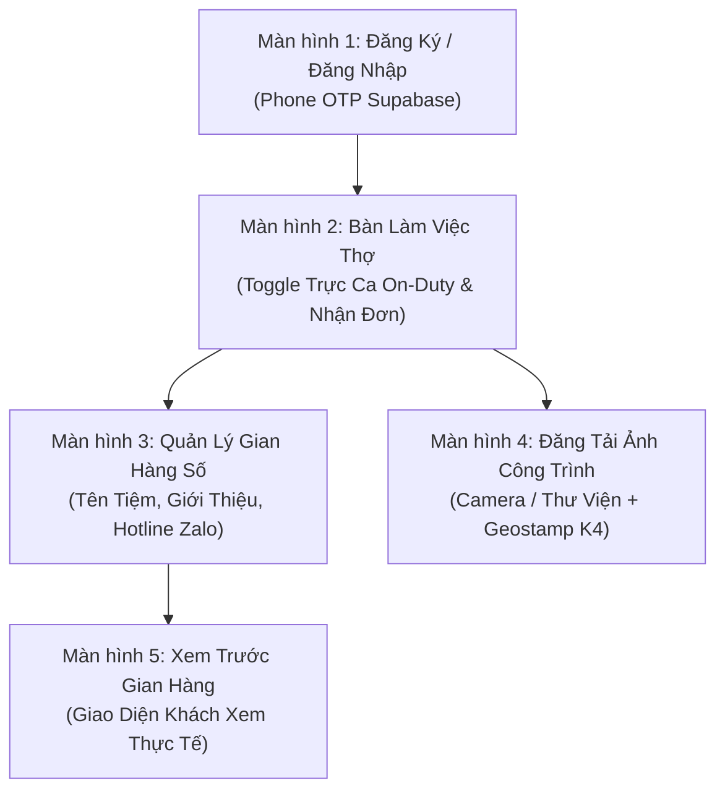

# THIẾT KẾ GIAO DIỆN & LUỒNG THAO TÁC ADALO CHO GIAN HÀNG THỢ 6K
**CÔNG TY TNHH THƯƠNG MẠI ĐẤT PHÚ (MST: 4401020233)**  
*Trụ sở: Số 21/146 Ngô Gia Tự, P. Phú Yên, TP. Tuy Hòa, Tỉnh Phú Yên*  
*Giải pháp No-Code / Low-Code: Adalo Mobile App kết hợp Supabase REST API & n8n Webhook*

---

## 1. CẤU TRÚC BỘ SƯU TẬP DỮ LIỆU TRÊN ADALO (COLLECTIONS)

Để đồng bộ hai chiều với Supabase PostgreSQL, cấu hình External Collections trên Adalo như sau:

| Tên Collection | Trường Dữ Liệu (Properties) | Mục Đích |
| :--- | :--- | :--- |
| **Technicians** | `id`, `full_name`, `phone`, `avatar`, `duty_status` (True/False), `current_lat`, `current_lng`, `rating`, `tier` | Quản lý danh tính và trạng thái ca trực |
| **Storefronts** | `id`, `technician_id` (Relationship), `store_title`, `bio`, `service_district`, `cover_image`, `hotline`, `zalo` | Thông tin gian hàng số cá nhân |
| **Portfolio_Images** | `id`, `storefront_id` (Relationship), `image` (Image property), `title`, `category_tag`, `location_geostamp`, `date` | Kho ảnh thực tế các công trình đã sửa |
| **Shift_Settlements** | `id`, `technician_id`, `shift_date`, `completed_jobs`, `earnings_95`, `cod_collected`, `payout_status` | Đối soát tài chính chốt ca hàng ngày |

---

## 2. THIẾT KẾ 5 MÀN HÌNH NÒNG CỐT TRÊN ADALO (SCREEN ARCHITECTURE)

---

### MÀN HÌNH 1: ĐĂNG KÝ & ĐĂNG NHẬP THỢ (AUTHENTICATION SCREEN)
* **Thành phần UI:**
  * Logo Đất Phú Kín Kẽ (Màu Đỏ `#D32027` & Xanh `#1B2A6B`).
  * Text Input: `Số điện thoại thợ` (VD: `0977.334.455`).
  * Dropdown chọn chuyên môn chính: *Điện Lạnh, Điện Nước, Xe Máy 78, Khóa & Cửa*.
  * Nút Button: **"Nhận Mã OTP Đăng Nhập"** $\rightarrow$ Action: Call Supabase Auth API $\rightarrow$ Link to Screen 2.

---

### MÀN HÌNH 2: TRUNG TÂM CA TRỰC & BẬT ON-DUTY (DUTY CONTROL COCKPIT)
* **Thành phần UI:**
  * Toggle Switch lớn: **"Trực Ca Sẵn Sàng"** (Xanh lá cây `#10B981`).
    * Khi bật ON: Adalo kích hoạt Custom Action gửi GPS hiện tại (`current_lat`, `current_lng`) lên Supabase `dp_technicians`.
    * Khi tắt OFF: Cập nhật `duty_status = 'off_duty'`, ngắt phân bổ đơn.
  * Card Thống Kê Nhanh: Số ca hôm nay, Thu nhập tạm tính 95%, Đánh giá sao (★ 5.0).
  * Danh sách đơn khẩn cấp được phân bổ (List component lọc theo `assigned_technician_id = LoggedInUser.id`).
  * Hai nút chuyển hướng nhanh: **"Chỉnh Sửa Gian Hàng"** & **"Đăng Ảnh Dự Án"**.

---

### MÀN HÌNH 3: THIẾT LẬP GIAN HÀNG SỐ (STOREFRONT PROFILE BUILDER)
* **Thành phần UI:**
  * Image Picker: Ảnh bìa xưởng/tiệm và Ảnh đại diện thợ có đồng phục.
  * Text Input: `Tiêu đề gian hàng` (VD: *Điện Lạnh Phú Yên Chuyên Nghiệp - Thợ Phú*).
  * Multi-line Text: `Kinh nghiệm & Cam kết` (*12 năm sửa chữa Inverter, hút chân không gas chuẩn, bảo hành 6 tháng QR*).
  * Text Input: `Khu vực phục vụ` (*Nội ô Tuy Hòa, Phú Hòa, Đông Hòa*).
  * Nút Button: **"Lưu & Xuất Bản Gian Hàng"** $\rightarrow$ Action: Update Storefront Collection $\rightarrow$ Link to Screen 5 (Xem trước).

---

### MÀN HÌNH 4: ĐĂNG TẢI ẢNH CÔNG TRÌNH THỰC TẾ (PORTFOLIO UPLOADER)
* **Thành phần UI:**
  * Image Picker / Camera Button: **"Chụp ảnh trực tiếp hoặc tải từ thư viện"** (Hỗ trợ định dạng JPG, PNG).
  * Text Input: `Tên công việc / Thiết bị` (VD: *Lắp đặt hoàn thiện máy lạnh Daikin Inverter tại Phường 7*).
  * Dropdown Tag chuyên mục: *Điện Lạnh, Điện Dân Dụng, Cấp Thoát Nước, Xe Cũ 78, Khóa Cửa*.
  * Geostamp Input (Tự động điền theo GPS hiện tại): *Số 12 Nguyễn Huệ, P.5, TP. Tuy Hòa*.
  * Nút Button: **"🚀 Đăng Ảnh Lên Gian Hàng Số"**
    * Action 1: Upload ảnh lên Supabase Storage bucket `worker-portfolios`.
    * Action 2: Trigger Webhook n8n (`POST /webhook/technician-image-upload`) để AI Vision kiểm duyệt tự động.
    * Action 3: Hiển thị thông báo: *✔ Đã tải lên thành công! Ảnh hiển thị công khai trên gian hàng của bạn.*

---

### MÀN HÌNH 5: GIAN HÀNG SỐ CÔNG KHAI (PUBLIC STOREFRONT PREVIEW)
* **Thành phần UI:**
  * Banner ảnh bìa + Ảnh avatar gắn huy hiệu **"★ Thợ Vàng 6K Kín Kẽ"**.
  * Bảng thông số: `★ 5.0 (142 ca)` • `Tỷ lệ có mặt 15P: 99%` • `Bảo hành QR: 6 tháng`.
  * Lưới ảnh công trình thực tế (Gallery Grid 2 cột): Hiển thị tất cả ảnh đã duyệt kèm nhãn Geostamp địa phương.
  * Hai nút bấm gọi: **"Gọi Cứu Hộ Ngay"** (`tel:0977334455`) & **"Nhắn Tin Zalo"** (`https://zalo.me/0977334455`).
