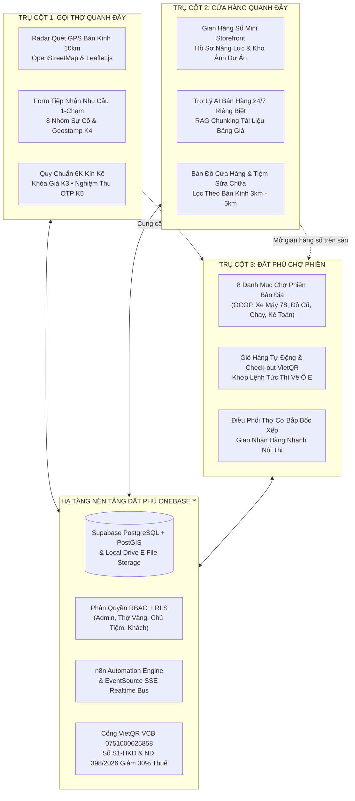
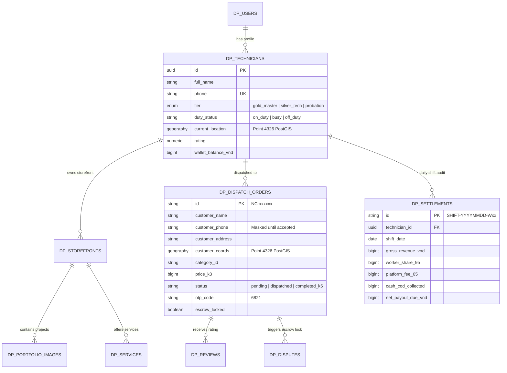
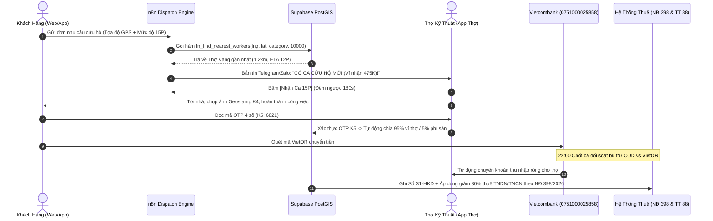

# KIẾN TRÚC TỔNG THỂ HỆ SINH THÁI ĐẤT PHÚ ONEBASE™
### TAM TRỤ VẬN HÀNH: GỌI THỢ QUANH ĐÂY • CỬA HÀNG QUANH ĐÂY • ĐẤT PHÚ CHỢ PHIÊN
**Đơn vị chủ quản:** CÔNG TY TNHH THƯƠNG MẠI ĐẤT PHÚ (MST: `4401020233`)  
**Giám đốc đại diện:** Phạm Thanh Hân  
**Trụ sở điều phối:** Số 21/146 Ngô Gia Tự, Phường Phú Yên, TP. Tuy Hòa, Tỉnh Phú Yên  
**Tài khoản thanh toán:** Vietcombank — `0751000025858` (CONG TY TNHH THUONG MAI DAT PHU)  
**Triết lý công nghệ:** *Kín Kẽ OS™ • Tinh Gọn (Asset-Light) • Bảo Chứng 6K Thực Chiến*

---

## 1. TỔNG QUAN MÔ HÌNH TAM TRỤ (TRI-PILLAR ECOSYSTEM TOPOLOGY)

Hệ sinh thái số Đất Phú OneBase được cấu trúc thành **3 trụ cột tương hỗ khép kín**, cùng chia sẻ chung hạ tầng dữ liệu không gian PostGIS, cổng thanh toán VietQR Escrow và đường ống kế toán thuế tự động:

---

## 2. PHÂN TÍCH CHI TIẾT 3 TRỤ CỘT VẬN HÀNH

### 🛠️ Trụ Cột 1: "Gọi Thợ Quanh Đây" (On-Demand 6K Labor Dispatch)
* **Đối tượng phục vụ:** Khách hàng gặp sự cố khẩn cấp về điện lạnh, chập điện, vỡ ống nước, kẹt khóa, hỏng xe máy tại TP. Tuy Hòa, Phú Hòa, Đông Hòa, Tuy An.
* **Quy trình 6 Bước Kín Kẽ OS™ (6K Standard):**
  1. **K1 - Định Danh & GPS:** Xác thực tay nghề thợ bản địa, quét định vị GPS thợ đang ở trạng thái `on_duty` trong bán kính 10km.
  2. **K2 - Khớp Nhu Cầu Tự Động:** Thuật toán PostGIS `ST_DWithin` và n8n tự động lọc thợ có chuyên môn chính xác (Điện, Nước, Xe máy...).
  3. **K3 - Khóa Giá Niêm Yết:** Biểu giá niêm yết cứng công khai (VD: Tháo lắp máy lạnh 500K, sửa chập điện 350K, thông nghẹt 250K), cam kết không phát sinh phụ phí.
  4. **K4 - Đóng Dấu Ảnh Geostamp:** Thợ chụp ảnh hiện trường có tọa độ GPS và mốc giờ lưu trữ vào thư mục [`E:\datphu-onebase\data\storage\images\`](file:///e:/datphu-onebase/data/storage/images/).
  5. **K5 - Nghiệm Thu Bằng Mã OTP:** Khách kiểm tra thiết bị chạy tốt mới cung cấp **mã OTP 4 số (VD: `6821`)**. Hệ thống mới tự động giải ngân **95% về ví thợ**, 5% phí sàn.
  6. **K6 - Bảo Hành Điện Tử QR:** Phát hành mã QR bảo hành 3–12 tháng. Khách tra cứu hạn bảo hành và gọi thợ bảo hành tận nhà miễn phí.

---

### 🏪 Trụ Cột 2: "Cửa Hàng Quanh Đây" (Verified Local Showrooms & Storefronts)
* **Đối tượng phục vụ:** Các tiệm cơ điện lạnh, xưởng mộc, gara xe máy 78, cửa hàng thiết bị nước, cửa hàng vật liệu và hộ kinh doanh tại Phú Yên.
* **Các thành phần nòng cốt:**
  1. **Gian Hàng Số Mini Storefront ([`tho_gian_hang.html`](file:///e:/datphu-onebase/tho_gian_hang.html)):** Mỗi chủ tiệm hoặc thợ sở hữu một gian hàng riêng hiển thị thông tin giới thiệu, danh mục dịch vụ, số hotline, Zalo và huy hiệu **Xác Thực 6K**.
  2. **Kho Ảnh Dự Án Thực Tế (Portfolio Gallery):** Thợ và chủ tiệm đăng tải hình ảnh các công trình đã sửa chữa thực tế kèm nhãn định vị địa phương (P.5, P.7, Tuy Hòa...) để tạo uy tín với khách hàng.
  3. **Trợ Lý AI Riêng Biệt Từng Gian Hàng:** Tích hợp Chatbox AI tự động tư vấn báo giá 24/7 theo tài liệu nạp riêng (RAG Vector Pipeline) cho từng cửa hàng (VD: *Đặc sản Chị Ba, Kế toán Thuế Đất Phú, Siêu thị Nam Tiến, Bếp chay Tâm Đức*).
  4. **Bản Đồ Tiệm Quanh Đây:** Khách hàng dễ dàng tìm kiếm và xem các tiệm đang mở cửa trong bán kính 3km – 5km quanh vị trí hiện tại.

---

### 🛍️ Trụ Cột 3: "Đất Phú Chợ Phiên" (E-Commerce Marketplace & Hybrid Commerce)
* **Đối tượng phục vụ:** Người tiêu dùng địa phương, khách du lịch, hộ gia đình mua sắm đặc sản OCOP, sách cũ, xe máy cũ và dịch vụ số.
* **Giao diện sàn thương mại:** [`ecommerce_marketplace.html`](file:///e:/datphu-onebase/ecommerce_marketplace.html).
* **8 Nhóm Ngành Hàng Đặc Sắc:**
  1. `ocop`: Đặc sản Nẫu Xứ Nẫu (Bò một nắng, muối kiến vàng, nước mắm cá cơm Phú Yên).
  2. `docu_sach`: Sách cũ văn hóa, đồ gia dụng tuyển chọn, đồ cổ tái sử dụng.
  3. `xecu`: Chợ xe máy cũ, xe điện biển 78 được thợ 6K kiểm định 18 hạng mục.
  4. `suata`: Sữa, tã và đồ dùng mẹ & bé giao nhanh 30 phút.
  5. `chay`: Ẩm thực thực dưỡng và đồ chay thanh tịnh Tâm Đức.
  6. `kythuat`: Dịch vụ gọi thợ kỹ thuật, cứu hộ điện máy, cải tạo nhà cửa.
  7. `ketoan`: Dịch vụ kế toán trọn gói, đối soát hóa đơn TCT Thông tư 78, tối ưu thuế NĐ 398.
  8. `bocxep`: Dịch vụ thuê thợ cơ bắp chuyển trọ, dọn tiệm, vận tải nội tỉnh.
* **Thanh Toán VietQR & Đối Soát Escrow Kín Kẽ:**
  * Khách quét mã VietQR tự động khớp số tiền và nội dung đơn hàng vào tài khoản công ty **Vietcombank: 0751000025858**.
  * Tiền được giữ an toàn (Escrow) và chỉ giải ngân cho người bán/thợ khi đơn hàng được giao thành công hoặc có biên bản nghiệm thu K5.

---

## 3. KIẾN TRÚC DỮ LIỆU & BẢO MẬT KHÔNG GIAN (DATA & SECURITY)

### Chính Sách Row-Level Security (RLS) & Bảo Mật Dữ Liệu
1. **Masked Customer Contacts:** Trước khi thợ bấm nhận ca, số điện thoại khách bị che `0914***341` và địa chỉ hiển thị dạng ước lượng `Bán kính ~1.2km (P.5 Tuy Hòa)`. Khi thợ bấm nhận đơn, hệ thống mới gỡ che (unmask).
2. **Technician Storefront Isolation:** Thợ chỉ được chỉnh sửa gian hàng, kho ảnh và dịch vụ của chính mình (`technician_id = auth.uid()`).
3. **Escrow Lock 24H:** Khi có khiếu nại phát sinh từ khách hàng, hệ thống tự động đóng băng 95% tiền trong ví thợ trong 24 giờ cho đến khi Thợ Trưởng Nhóm thẩm định xong.

---

## 4. ĐƯỜNG ỐNG TỰ ĐỘNG HÓA n8n & ĐỐI SOÁT TÀI CHÍNH THUẾ

---

## 5. BẢNG TỔNG HỢP CÁC TỆP NGUỒN ĐÃ TRIỂN KHAI VÀ LIÊN KẾT

| Tên Tệp Nguồn | Vị Trí Lưu Trữ | Vai Trò & Chức Năng |
| :--- | :--- | :--- |
| [`goi_tho_6k.html`](file:///e:/datphu-onebase/goi_tho_6k.html) | `E:\datphu-onebase\` | Giao diện Gọi thợ 6K, bản đồ OpenStreetMap Radar 10km, Form nhu cầu và nghiệm thu OTP. |
| [`tho_gian_hang.html`](file:///e:/datphu-onebase/tho_gian_hang.html) | `E:\datphu-onebase\` | Cổng thợ PWA (Bàn làm việc, On-Duty toggle, Thiết lập gian hàng, Đăng ảnh dự án). |
| [`ecommerce_marketplace.html`](file:///e:/datphu-onebase/ecommerce_marketplace.html) | `E:\datphu-onebase\` | Sàn TMĐT Đất Phú Chợ Phiên, 8 danh mục, thanh toán VietQR và thanh điều hướng thợ. |
| [`server.js`](file:///e:/datphu-onebase/server.js) | `E:\datphu-onebase\` | Backend Node.js lưu CSDL cục bộ ổ E (`data/db/`), File storage (`data/storage/`) và Realtime SSE. |
| [`10_goi_tho_quanh_day_master_schema.sql`](file:///e:/datphu-onebase/supabase/migrations/10_goi_tho_quanh_day_master_schema.sql) | `E:\datphu-onebase\supabase\migrations\` | Toàn bộ CSDL Supabase PostgreSQL + hàm PostGIS tìm thợ 10km và bảng chốt ca. |
| [`11_technician_storefront_portfolio.sql`](file:///e:/datphu-onebase/supabase/migrations/11_technician_storefront_portfolio.sql) | `E:\datphu-onebase\supabase\migrations\` | CSDL Gian hàng số cá nhân thợ, kho ảnh công trình và chính sách bảo mật RLS. |
| [`workflow_auto_dispatch_gps_6k.json`](file:///e:/datphu-onebase/n8n/workflow_auto_dispatch_gps_6k.json) | `E:\datphu-onebase\n8n\` | Kịch bản n8n tự động phân bổ đơn theo GPS và gửi thông báo Telegram cho thợ. |
| [`workflow_technician_portfolio_moderation.json`](file:///e:/datphu-onebase/n8n/workflow_technician_portfolio_moderation.json) | `E:\datphu-onebase\n8n\` | Kịch bản n8n kiểm duyệt ảnh công trình thực tế có Geostamp K4. |
| [`LUONG_CHOT_CA_DOI_SOAT_THU_CHI_THO_6K.md`](file:///e:/datphu-onebase/docs/LUONG_CHOT_CA_DOI_SOAT_THU_CHI_THO_6K.md) | `E:\datphu-onebase\docs\` | Quy trình đối soát tài chính bù trừ COD vs VietQR, sổ `S1-HKD` và giảm 30% thuế NĐ 398. |
| [`TIEU_CHI_DANH_GIA_XEP_HANG_THO_6K.md`](file:///e:/datphu-onebase/docs/TIEU_CHI_DANH_GIA_XEP_HANG_THO_6K.md) | `E:\datphu-onebase\docs\` | Bộ tiêu chí đánh giá 4 trụ cột, phân hạng Thợ Vàng/Thợ Bạc và cơ chế Escrow Lock 24h. |
| [`ADALO_THIET_KE_GIAN_HANG_THO_6K.md`](file:///e:/datphu-onebase/docs/ADALO_THIET_KE_GIAN_HANG_THO_6K.md) | `E:\datphu-onebase\docs\` | Thiết kế cấu trúc 5 màn hình No-Code Adalo cho ứng dụng di động của thợ. |
