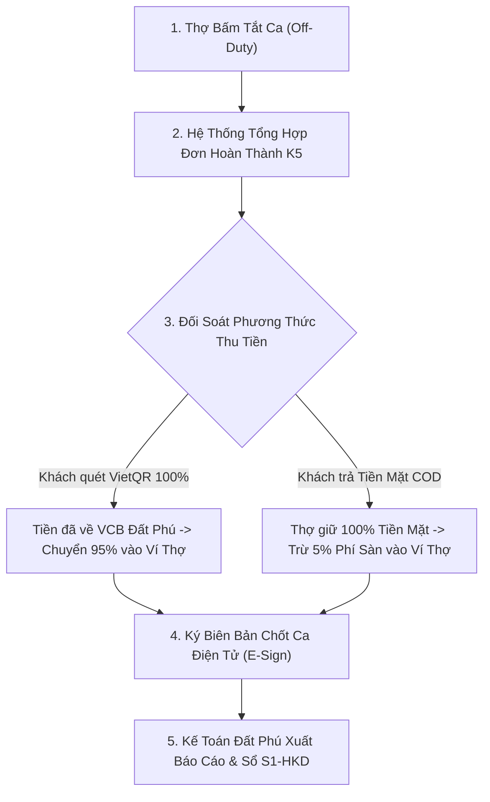

# QUY TRÌNH CHỐT CA VÀ ĐỐI SOÁT THU CHI THỢ KỸ THUẬT 6K
**CÔNG TY TNHH THƯƠNG MẠI ĐẤT PHÚ (MST: 4401020233)**  
*Trụ sở: Số 21/146 Ngô Gia Tự, P. Phú Yên, TP. Tuy Hòa, Tỉnh Phú Yên*  
*Tài khoản ngân hàng đối soát: Vietcombank - 0751000025858 (CONG TY TNHH THUONG MAI DAT PHU)*  
*Hệ thống vận hành: Đất Phú Kín Kẽ OS™ • Tiêu chuẩn 6K Labor & Commerce*

---

## 1. MỤC TIÊU VẬN HÀNH & NGUYÊN TẮC KÍN KẼ
1. **Minh bạch tài chính 100%:** Tự động phân chia 95% doanh thu về ví thợ kỹ thuật, 5% nộp phí nền tảng Đất Phú OneBase (duy trì GPS, tổng đài AI và Quỹ bảo chứng rủi ro K6).
2. **Không thất thoát tiền COD:** Đối soát chéo giữa dòng tiền thực nhận tại tài khoản Vietcombank với tiền mặt thợ thu hộ tận nhà khách hàng.
3. **Tuân thủ quy chuẩn kế toán & thuế:** Tích hợp Sổ doanh thu `S1-HKD` (Thông tư 88/2021/TT-BTC), Hóa đơn điện tử (Thông tư 78) và áp dụng chính sách giảm 30% thuế TNDN/TNCN theo Nghị định 398/2026/NĐ-CP (áp dụng cho doanh thu dưới 10 tỷ đồng).

---

## 2. QUY TRÌNH 4 BƯỚC CHỐT CA CUỐI NGÀY



---

### Bước 1: Kết Thúc Ca Trực & Khóa Nhận Đơn (Shift Cut-Off)
* **Thời điểm:** Lúc 21:30 hàng ngày hoặc khi thợ có nhu cầu nghỉ ngơi.
* **Thao tác của thợ:** Thợ truy cập giao diện tổng đài, gạt nút trạng thái từ `On-Duty` sang `Off-Duty`.
* **Hành vi hệ thống:**
  * PostGIS và kịch bản n8n tự động ngắt định vị GPS của thợ khỏi luồng quét bán kính 10km.
  * Khóa danh sách đơn trong ngày, chỉ tính các đơn có trạng thái `completed_k5` (đã xác thực mã OTP 4 số từ khách hàng).

---

### Bước 2: Phân Tách Doanh Thu 95/5 & Quỹ Bảo Hành K6
* Mọi đơn hàng đều được khóa cứng giá niêm yết theo danh mục K3.
* **Công thức phân bổ:**
  $$\text{Thu nhập ròng của thợ} = \text{Tổng giá trị đơn K3} \times 95\%$$
  $$\text{Phí nền tảng Đất Phú} = \text{Tổng giá trị đơn K3} \times 5\%$$

* **Ví dụ ca trực mẫu của thợ Nguyễn Văn Phú (Ngày 01/11/2026):**
  1. Đơn `NC-102918`: Tháo lắp máy lạnh Inverter = 500.000đ (Khách quét VietQR)
  2. Đơn `NC-102925`: Vệ sinh máy lạnh = 150.000đ (Khách trả Tiền mặt)
  3. Đơn `NC-102940`: Nạp gas R32 = 250.000đ (Khách quét VietQR)
  * **Tổng doanh thu gộp:** $900.000\text{ đ}$
  * **Thu nhập thợ (95%):** $855.000\text{ đ}$
  * **Phí sàn Đất Phú (5%):** $45.000\text{ đ}$

---

### Bước 3: Cơ Chế Bù Trừ Thu Chi (VietQR vs COD Tiền Mặt)
Hệ thống kế toán tự động cân đối dòng tiền để thợ không cần phải nộp tiền mặt lặt vặt về văn phòng:

1. **Dòng tiền Công ty đang giữ hộ thợ (Qua VietQR VCB):**
   * Đơn 1 + Đơn 3 = $500.000 + 250.000 = 750.000\text{ đ}$
2. **Dòng tiền Thợ đang cầm của Công ty (Tiền mặt COD):**
   * Đơn 2 = $150.000\text{ đ}$
3. **Quyết toán bù trừ cuối ca:**
   $$\text{Số tiền Đất Phú chuyển khoản cho thợ} = \text{Thu nhập 95\%} - \text{Tiền mặt thợ đã thu}$$
   $$\text{Thực nhận} = 855.000\text{ đ} - 150.000\text{ đ} = 705.000\text{ đ}$$
* Lệnh chi tự động qua ngân hàng được thực hiện vào **22:00 cùng ngày**, thợ nhận đủ tiền vào tài khoản cá nhân.

---

### Bước 4: Đồng Bộ Chứng Từ Kế Toán & Giảm 30% Thuế (Nghị định 398/2026/NĐ-CP)
1. **Sổ Doanh Thu S1-HKD:**
   * Tự động ghi chép vào phần mềm kế toán theo từng ca trực, gắn liền với hợp đồng hợp tác lao động kỹ thuật tự do 6K.
2. **Kê khai thuế theo Nghị định 398/2026/NĐ-CP:**
   * Doanh thu năm của Công ty Thương Mại Đất Phú và các hộ kỹ thuật liên kết dưới ngưỡng 10 tỷ đồng $\rightarrow$ **Được giảm 30% số thuế TNDN và TNCN phải nộp**.
   * Áp dụng Mẫu 01 / Mẫu 02 kèm tờ khai thuế định kỳ quý.
3. **Cấp Phiếu Bảo Hành Điện Tử QR (K6):**
   * Hệ thống tự động phát sinh mã QR bảo hành 6 tháng gửi qua Zalo/SMS cho khách hàng, gắn mã ID thợ để đảm bảo trách nhiệm bảo hành nghiêm túc.

---

## 3. MẪU BIÊN BẢN ĐỐI SOÁT CHỐT CA (XUẤT FILE EXCEL / PDF)

```text
========================================================================
             BIÊN BẢN ĐỐI SOÁT CA TRỰC KỸ THUẬT 6K — ĐẤT PHÚ
Ngày trực: 01/11/2026 | Mã ca trực: SHIFT-20261101-W01
Thợ kỹ thuật: NGUYỄN VĂN PHÚ | Mã thợ: w_01 | SĐT: 0977.334.455
Khu vực: P.5, TP. Tuy Hòa, Phú Yên
------------------------------------------------------------------------
1. Tổng số ca hoàn thành (OTP K5): 03 ca
2. Tổng doanh thu niêm yết K3:     900.000 VNĐ
3. Thu nhập thợ hưởng (95%):       855.000 VNĐ
4. Phí sàn Đất Phú OneBase (5%):    45.000 VNĐ
5. Tiền khách trả VietQR (VCB):    750.000 VNĐ (Công ty thu hộ)
6. Tiền mặt thợ thu tại nhà (COD): 150.000 VNĐ (Thợ đang giữ)
------------------------------------------------------------------------
SỐ TIỀN CÔNG TY QUYẾT TOÁN CHO THỢ: 705.000 VNĐ
Trạng thái: [ĐÃ DUYỆT ĐỐI SOÁT TỰ ĐỘNG — CHUYỂN KHOẢN 22:00]
========================================================================
```
