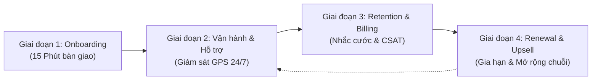
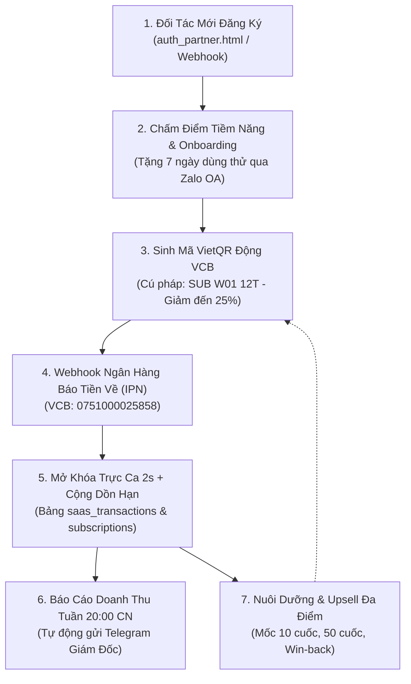
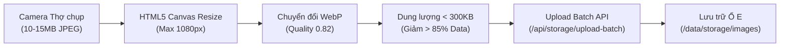

# SỔ TAY HÀNH ĐỘNG 2026: QUY TRÌNH VẬN HÀNH & CHĂM SÓC KHÁCH HÀNG SAU KHI THUÊ PHẦN MỀM (SAAS & GIAN HÀNG SỐ ĐẤT PHÚ)

> **CÔNG TY TNHH THƯƠNG MẠI ĐẤT PHÚ**  
> **Mã số thuế:** 4401020233  
> **Địa chỉ:** Số 21/146 Ngô Gia Tự, Phường Phú Đông, TP. Tuy Hòa, Tỉnh Phú Yên  
> **Tài khoản Vietcombank:** `0751000025858` (Phạm Thanh Hân - Giám đốc)  
> **Hotline điều hành 24/7:** 0935.889.900  
> **Hệ sinh thái:** Đất Phú Kín Kẽ OS™ Gen 4 — Nền tảng Gọi Thợ Quanh Đây 6K & Chợ Phiên Số  

---

## I. MỤC TIÊU CHIẾN LƯỢC VÀ NGUYÊN TẮC VẬN HÀNH

Mô hình cho thuê phần mềm (SaaS) và Gian hàng số của Đất Phú được thiết kế để giải quyết bài toán cốt lõi: **"Không thu hoa hồng cuốc thợ – Thợ giữ 100% tiền công – Sàn thu phí định kỳ minh bạch, dòng tiền bền vững"**.

Để tối ưu hóa tỷ lệ giữ chân khách hàng (Retention Rate > 95%), giảm thiểu tỷ lệ rời bỏ (Churn Rate < 5%) và biến mỗi thợ kỹ thuật thành một đại sứ thương hiệu uy tín, Sổ tay này chuẩn hóa **Quy trình 4 Giai đoạn Vận hành & Chăm sóc Khách hàng Thực chiến 2026** theo đúng tinh thần **Kín Kẽ – Minh Bạch – Tốc Độ**.



---

## II. QUY TRÌNH 4 GIAI ĐOẠN CHĂM SÓC KHÁCH HÀNG SAAS CHUẨN HÓA

### 🚀 GIAI ĐOẠN 1: KÍCH HOẠT & BÀN GIAO NHANH CHÓNG (ONBOARDING)
**Mục tiêu:** Giúp thợ/cửa hàng nhận được giá trị đầu tiên (First Value Moment) trong vòng **15 phút** sau khi đăng ký hoặc nộp cước.

#### 1.1. Luồng kích hoạt tự động (Zero-Touch Activation)
1. **Khởi tạo dữ liệu trên Supabase & Local Database:**
   - Ngay khi thợ đăng ký qua `auth_partner.html` hoặc nộp phí VietQR thành công:
   - Hệ thống tự động tạo mã định danh thợ `w_XX` và liên kết với bảng `partner_subscriptions`.
   - Cấp quyền truy cập 1 **"Gian hàng số cá nhân" (Mini Storefront)** tại địa chỉ duy nhất: `http://localhost:3456/tho_gian_hang.html?workerId=w_XX`.
   - Cấp huy hiệu kiểm định: **THỢ VÀNG 6K** (đối với cá nhân) hoặc **ĐỐI TÁC KHU VỰC** (đối với cửa hàng).

2. **Bàn giao Bộ công cụ "Thực chiến 3 bước":**
   - **Bước 1 – Hoàn thiện hồ sơ:** Hướng dẫn cập nhật ảnh đại diện thẻ nghề và số điện thoại nhận đơn cứu hộ.
   - **Bước 2 – Tải ảnh Geostamp:** Tải tối thiểu 3 ảnh công trình đã sửa chữa thực tế lên kho Portfolio có đóng dấu định vị Tuy Hòa / Phú Yên.
   - **Bước 3 – Bật Trực Ca Sẵn Sàng:** Hướng dẫn cách bấm nút *"Trực Ca Sẵn Sàng"* để radar PostGIS đưa thợ lên bản đồ cứu hộ 15 phút.

3. **Xác nhận kết nối & Cuộc gọi Chào mừng:**
   - Tự động gửi tin nhắn Zalo OA thông báo:
     > *"Chào mừng Anh [Tên Thợ] đã gia nhập Đội Thợ Kỹ Thuật Đất Phú 6K. Gian hàng số của anh đã sẵn sàng tại [Link Gian Hàng]. Chúc anh một tháng đầy cuốc và thuận buồm xuôi gió!"*
   - Trong vòng 2 giờ làm việc, điều phối viên gọi điện thoại kiểm tra kết nối âm thanh và bảo đảm thợ đã nắm rõ cơ chế nhận cuốc.

---

### 🛡️ GIAI ĐOẠN 2: VẬN HÀNH ĐỊNH KỲ & HỖ TRỢ KỸ THUẬT 24/7 (OPERATION & SUPPORT)
**Mục tiêu:** Duy trì sự ổn định 99.9% của radar điều phối, giải quyết mọi vướng mắc phát sinh trong quá trình trực ca.

#### 2.1. Giám sát tự động qua n8n và WebSocket
- **Giám sát tín hiệu GPS:** Nếu thợ bật *"Trực Ca"* nhưng không cập nhật tọa độ GPS quá 120 phút, hệ thống tự động gửi cảnh báo đẩy nhắc nhở kiểm tra sóng 4G/GPS.
- **Giám sát trượt đơn:** Nếu một thợ bị trôi quá 3 đơn cứu hộ liên tiếp do không phản hồi, tổng đài tự động hạ ưu tiên tạm thời và chuyển đơn cho thợ phụ cận để giữ cam kết *15P Có mặt* với khách hàng.

#### 2.2. Cam kết chất lượng dịch vụ hỗ trợ (SLA Hỗ Trợ 2026)
| Kênh tiếp nhận | Thời gian phản hồi đầu tiên | Thời gian giải quyết dứt điểm | Trách nhiệm xử lý |
| :--- | :--- | :--- | :--- |
| **Hotline Khẩn cấp 24/7** | < 30 giây | < 10 phút | Trực ban Tổng đài Đất Phú |
| **Zalo OA Hỗ Trợ Kỹ Thuật** | < 3 phút | < 30 phút | Kỹ sư Vận hành Phần mềm |
| **Khiếu nại Khách hàng – Thợ** | < 15 phút | < 2 giờ (Theo quy chuẩn Kín Kẽ) | Ban Pháp chế & Giám đốc Điều hành |

#### 2.3. Tối ưu hóa gian hàng định kỳ (Monthly Health-Check)
- Mỗi tháng 1 lần, chuyên viên vận hành rà soát gian hàng của thợ:
  - Tối ưu hóa từ khóa tìm kiếm (Ví dụ: "sửa máy giặt Tuy Hòa", "thông tắc cống Phú Lâm").
  - Gợi ý bổ sung hình ảnh công trình mới để tăng điểm uy tín đánh giá (Rating > 4.8★).
  - Cập nhật biểu giá niêm yết vật tư thay thế theo giá gốc Chợ Phiên Đất Phú.

---

### 💳 GIAI ĐOẠN 3: CHĂM SÓC CHỦ ĐỘNG & NHẮC PHÍ TỰ ĐỘNG (RETENTION & BILLING)
**Mục tiêu:** Tự động hóa 100% quy trình thu cước, không dùng nhân viên gọi điện đòi nợ thợ gây phản cảm, duy trì mối quan hệ đối tác tôn trọng.

#### 3.1. Lịch trình nhắc phí tự động n8n (Automated Billing Schedule)
Hệ thống cron tự động quét CSDL mỗi sáng lúc 07:00 AM và gửi tin nhắn Zalo OA theo kịch bản:

```
[Ngày T-5] ──> Gửi Tin Nhắn Chúc Mừng & Báo Cáo Cuốc + VietQR Chiết Khấu Sớm (-15% đến -25%)
      │
[Ngày T-3] ──> Gửi Form Khảo Sát Hài Lòng (CSAT) + Tặng Voucher -5% Gia Hạn
      │
[Ngày T-1] ──> Nhắc Hạn Cuối + Cảnh Báo Bảo Lưu Thứ Hạng Radar GPS & Huy Hiệu Thợ Vàng 6K
      │
[Ngày T]   ──> Hạn Chót (Chuyển sang 48H Grace Period) + Thông Báo Tạm Khóa Trực Ca
      │
[Thanh Toán]─> Mở Khóa Tự Động Trong 2 Giây + Gửi Hóa Đơn Điện Tử Đất Phú
```

#### 3.2. Thu thập phản hồi và Khảo sát độ hài lòng (CSAT Form)
- Định kỳ vào ngày **T-3** trước kỳ gia hạn hoặc sau **30 ngày hoạt động**, hệ thống gửi link [Form Khảo Sát Thợ](file:///e:/datphu-onebase/khao_sat_tho.html).
- **Cơ chế khuyến khích (Incentive):** Thợ hoàn tất khảo sát (chấm 4 tiêu chí + góp ý) được tặng ngay mã giảm giá **-5%** trừ trực tiếp vào hóa đơn thuê bao tháng tới.
- Mọi ý kiến đánh giá < 3 sao sẽ lập tức kích hoạt thông báo đỏ cho Điều hành viên gọi điện lắng nghe và hỗ trợ khắc phục.

---

### 📈 GIAI ĐOẠN 4: GIA HẠN & NÂNG CẤP GÓI CƯỚC (RENEWAL & UPSELL)
**Mục tiêu:** Gia tăng giá trị trọn đời khách hàng (LTV), chuyển đổi thợ cá nhân thành Cửa hàng/Tổ đội dịch vụ, đưa đối tác lớn thành Cổ đông Node khu vực.

#### 4.1. Chính sách thưởng gia hạn dài hạn (Advance Payment Incentives)
Thợ đóng cước trước được hưởng chính sách giá đặc quyền:
- **Chu kỳ 3 tháng:** Giảm **5%** tổng cước.
- **Chu kỳ 6 tháng:** Giảm **15%** tổng cước (Tiết kiệm tương đương gần 1 tháng phí).
- **Chu kỳ 12 tháng:** Giảm **25%** tổng cước + **Tặng thêm 1 tháng miễn phí** + Tặng gói Cài đặt Bot AI Tiếp nhận đơn Zalo miễn phí.

#### 4.2. Lộ trình Upsell tự nhiên theo quy mô đối tác
1. **Thợ độc lập (Gói Khởi nghiệp 290k/tháng):**
   - *Dấu hiệu nâng cấp:* Thợ nhận trên 40 cuốc/tháng, thường xuyên quá tải phải từ chối đơn.
   - *Hành động tư vấn:* Gợi ý tuyển thêm 1-2 thợ phụ và nâng cấp lên **Gói Doanh Nghiệp Địa Phương (890k/tháng)** để chia đơn tự động cho thợ phụ.
2. **Cửa hàng / Đội thợ (Gói Doanh nghiệp 890k/tháng):**
   - *Dấu hiệu nâng cấp:* Mở thêm chi nhánh ở TX Sông Cầu, Đông Hòa hoặc phát sinh kho vật tư lớn.
   - *Hành động tư vấn:* Nâng cấp lên **Gói Đất Phú Enterprise (1.99M/tháng)** để tích hợp kho vật tư Chợ Phiên và báo cáo kế toán TT88 chuẩn hóa.
3. **Đơn vị phân phối chiến lược (Gói Sovereign Meta-Node 4.5M/tháng):**
   - Cấp độc quyền điều phối đơn hàng và phân phối tài khoản cấp dưới toàn Huyện/Thị xã.

---

## III. CHỈ SỐ ĐO LƯỜNG VẬN HÀNH CỐT LÕI (KPIs 2026)

| Chỉ số | Mục tiêu chuẩn 2026 | Công thức tính | Hành động khắc phục khi không đạt |
| :--- | :--- | :--- | :--- |
| **Onboarding TTV** | < 15 phút | Thời gian từ lúc đăng ký đến khi bật Trực Ca thành công | Tối giản biểu mẫu đăng ký, cử chuyên viên hỗ trợ 1-1 |
| **Tỷ lệ giữ chân (Retention Rate)** | > 92% / tháng | Số thợ gia hạn kỳ tiếp theo / Tổng thợ đang dùng | Rà soát lượng đơn phân bổ, áp dụng voucher kích cầu |
| **Chỉ số hài lòng (CSAT)** | > 4.6 / 5.0 | Điểm trung bình từ biểu mẫu khảo sát thợ | Trực tiếp họp tổ thợ giải quyết khúc mắc |
| **Tỷ lệ thanh toán tự động VietQR** | > 85% | Số giao dịch VietQR quét tự động / Tổng giao dịch thu cước | Cải tiến giao diện hiển thị mã QR trên ứng dụng thợ |
| **Thời gian kích hoạt mở khóa sau nộp cước** | < 2 giây | Thời gian phản hồi của Webhook VietQR ngân hàng | Kiểm tra webhook n8n và kết nối socket |

---

## IV. BẢO MẬT & TÍNH PHÁP LÝ HỢP ĐỒNG ĐIỆN TỬ

- Mọi gói thuê bao SaaS được ký kết thông qua **Điều khoản Dịch vụ Điện tử (E-Terms of Service)** khi thợ bấm đồng ý trên `auth_partner.html`.
- Biên lai thu tiền và lịch sử thanh toán được lưu trữ bất biến trên hệ thống CSDL Đất Phú, sẵn sàng xuất hóa đơn GTGT điện tử dịch vụ phần mềm theo quy định của Tổng cục Thuế và Sở TT&TT Tỉnh Phú Yên.

---

## V. QUY CHUẨN BỨC TƯỜNG LỬA 3 TẦNG & AN NINH MÁY CHỦ (3-TIER FIREWALL STANDARD)

Để bảo vệ hạ tầng máy chủ, phần mềm SaaS và dữ liệu thợ/cửa hàng trước các cuộc tấn công mạng, Đất Phú áp dụng mô hình **Bức Tường Lửa 3 Tầng** theo nguyên tắc **"Asset-Light nhưng Kín Kẽ Tuyệt Đối"**:

```
[Internet / External Traffic]
       │
       ▼
┌────────────────────────────────────────────────────────┐
│ TẦNG 1: Edge Firewall / Cloudflare / WAF (Chặn từ cửa) │
└──────────────────────────┬─────────────────────────────┘
                           │
                           ▼
┌────────────────────────────────────────────────────────┐
│ TẦNG 2: Host / Server Firewall (UFW & Fail2Ban)        │
└──────────────────────────┬─────────────────────────────┘
                           │
                           ▼
┌────────────────────────────────────────────────────────┐
│ TẦNG 3: Database & Application Security (Supabase RLS) │
└────────────────────────────────────────────────────────┘
```

### 1. Chi tiết thiết lập 3 tầng tường lửa
* **Tầng 1 - Edge Firewall / WAF (Chặn từ cửa):**
  - **Chống DDoS & Botnet:** Tự động phát hiện và chặn các công cụ quét tự động (`sqlmap`, `nikto`, `wpscan`, `dirbuster`).
  - **Rate Limiting:** Áp dụng ngưỡng 30 requests/giây toàn cục và giới hạn khắt khe 5 requests/phút tại điểm đăng nhập `/api/auth/login`.
  - **Ép buộc HTTPS:** Bắt buộc chuẩn SSL/TLS 1.3 với HSTS (2 năm), cấm toàn bộ kết nối HTTP không mã hóa.
* **Tầng 2 - Host-Based Firewall (UFW & Fail2Ban):**
  - **Chính sách Default Deny:** Khóa toàn bộ cổng vào (`sudo ufw default deny incoming`), chỉ mở kết nối ra ngoài (`default allow outgoing`).
  - **Đổi cổng SSH an toàn:** Chuyển cổng SSH từ 22 sang **cổng 2222** để vô hiệu hóa 99% các bot quét cổng SSH tự động trên internet.
  - **Chỉ mở cổng Web cốt lõi:** Cho phép duy nhất cổng `2222/tcp` (SSH), `80/tcp` (HTTP) và `443/tcp` (HTTPS).
  - **Giấu kín Core Engine Node.js:** Cổng `3456` chỉ chạy cục bộ `127.0.0.1` bên trong máy chủ, tuyệt đối không mở ra ngoài internet; mọi kết nối phải đi qua Nginx Reverse Proxy.
  - **Fail2Ban tự động hóa:** Khóa IP 24 giờ nếu nhập sai SSH 3 lần; khóa IP 2 giờ nếu thử sai mật khẩu ứng dụng $\ge 5$ lần.
* **Tầng 3 - Database Firewall & n8n Auto-Ban:**
  - **PostgreSQL Row-Level Security (RLS):** Người dùng chỉ truy cập được bản ghi thuộc phạm vi phân quyền, ngăn chặn đánh cắp dữ liệu chéo ngay cả khi lọt qua tầng mạng.
  - **n8n Auto-Ban IP:** n8n định kỳ giám sát bảng nhật ký an ninh `security_audit_logs.json`. Khi phát hiện IP vi phạm $\ge 5$ lần, tự động kích hoạt API đẩy IP vào danh sách đen UFW máy chủ.

### 2. Bộ công cụ cấu hình thực chiến đính kèm
* **Script tự động cài đặt UFW & Fail2Ban:** [**`scripts/setup_firewall_and_fail2ban.sh`**](file:///e:/datphu-onebase/scripts/setup_firewall_and_fail2ban.sh)
* **File cấu hình mẫu Nginx Reverse Proxy & WAF:** [**`nginx/datphu_firewall_reverse_proxy.conf`**](file:///e:/datphu-onebase/nginx/datphu_firewall_reverse_proxy.conf)
* **Tài liệu hướng dẫn chuyên sâu:** [**`docs/QUY_CHUAN_TUONG_LUA_VA_AN_NINH_MAY_CHU_2026.md`**](file:///e:/datphu-onebase/docs/QUY_CHUAN_TUONG_LUA_VA_AN_NINH_MAY_CHU_2026.md)

---

## VI. HỆ THỐNG "MẮT THẦN" GIÁM SÁT LỖI TỰ ĐỘNG N8N (ERROR MONITORING WORKFLOW)

Hệ thống giám sát lỗi tự động đóng vai trò là "Radar cảnh báo sớm", phát hiện tức thì mọi sự cố gián đoạn luồng tự động hóa n8n và bắn cảnh báo đa kênh về điện thoại quản trị viên:

```
[Bất kỳ Workflow n8n nào của Đất Phú]
       │
       ├─► (Thực thi thành công) ──► Tiếp tục bình thường
       └─► [XẢY RA LỖI (Error Trigger)]
                  │
                  ▼
         [Node: Error Trigger (N8N)]
                  │
                  ▼
         [Node: Code JavaScript (Bóc tách & Phân loại Severity)]
                  │
                  ▼
         ┌────────────────────────────────────────────────────────┐
         │ Node Gửi Cảnh Báo Đa Kênh & Lưu Vết Kiểm Toán Bất Biến │
         ├─► 1. Bắn tin nhắn khẩn cấp qua Telegram Bot (Tức thì)
         ├─► 2. Gửi Email chi tiết Stack Trace (thuongmaidatphu@gmail.com)
         ├─► 3. Ghi vào CSDL Supabase (Bảng system_error_logs)
         └─► 4. Hiển thị Realtime trên Admin Error Dashboard
```

### 1. Hướng dẫn thiết lập Error Workflow làm mặc định toàn hệ thống n8n
Có 2 phương thức kích hoạt:
* **Phương thức 1 - Thiết lập Biến Môi trường Toàn Cục (Khuyến nghị cho Server):**
  Trong file cấu hình môi trường `.env` của n8n, khai báo ID của workflow giám sát:
  ```env
  N8N_DEFAULT_ERROR_WORKFLOW_ID=wf_error_monitoring_handler
  ```
  Khởi động lại n8n: `docker compose restart n8n` hoặc `pm2 restart n8n`. Khi đó, bất kỳ workflow nào chạy lỗi trên toàn hệ thống đều sẽ tự động kích hoạt workflow này mà không cần cấu hình thủ công từng cái.
* **Phương thức 2 - Cấu hình trong Cài đặt từng Workflow (Workflow Settings):**
  Trong giao diện thiết kế workflow -> Bấm vào biểu tượng **Settings (Bánh răng)** ở góc trên bên phải -> Tại mục **Error Workflow**, chọn: `[SYSTEM] DatPhu - Error Monitoring Handler` -> Bấm **Save**.

### 2. Tiêu chuẩn phân loại mức độ nghiêm trọng sự cố (Severity Levels)
| Mức độ | Điều kiện nhận diện | Kênh cảnh báo | SLA xử lý |
| :--- | :--- | :--- | :--- |
| **CRITICAL** | Lỗi luồng Điều phối cứu hộ GPS 15P, cổng thanh toán VietQR VCB, Timeout CSDL | Telegram Bot + Chuông điện thoại + Email Admin | < 10 phút |
| **HIGH** | Lỗi gửi tin Zalo OA ZNS, nhắc phí quá hạn, API bên thứ ba trả mã 429/500 | Telegram Bot + Email Admin | < 30 phút |
| **MEDIUM** | Lỗi kiểm duyệt ảnh công trình Geostamp, độ phân giải thấp, cảnh báo warning | Ghi nhật ký Dashboard, duyệt thủ công | Trong ngày |
| **LOW** | Cảnh báo tối ưu hóa bộ nhớ đệm, log định kỳ | Lưu nhật ký kiểm toán | Cuối tuần |

### 3. Bộ công cụ & Bảng điều khiển đã triển khai
* **File Workflow n8n chuẩn:** [**`n8n/workflow_error_monitoring_handler.json`**](file:///e:/datphu-onebase/n8n/workflow_error_monitoring_handler.json)
* **Migration CSDL Supabase:** [**`supabase/migrations/13_system_error_monitoring_logs.sql`**](file:///e:/datphu-onebase/supabase/migrations/13_system_error_monitoring_logs.sql)
* **Bảng điều khiển trực quan (Dashboard):** [**`admin_error_dashboard.html`**](file:///e:/datphu-onebase/admin_error_dashboard.html)

---

## VII. NÂNG CAO HỆ THỐNG TỰ ĐỘNG BÁN HÀNG & BÁO CÁO DOANH THU SAAS (MASTER SALES FUNNEL & REVENUE AUTOMATION)

Để chuyển dịch từ việc thông báo đơn thuần sang một cỗ máy chốt đơn, thu cước tự động và giữ chân khách hàng (thợ, cửa hàng, đối tác), hệ thống triển khai 4 trụ cột chiến lược khép kín:



### 1. Cấu hình các luồng tự động hóa trọng tâm trên n8n
1. **Luồng Phễu Bán Hàng Master:** [**`n8n/workflow_saas_sales_funnel_master.json`**](file:///e:/datphu-onebase/n8n/workflow_saas_sales_funnel_master.json)
   - Tiếp nhận Webhook đối tác đăng ký ➔ Chấm điểm Lead Score (60-85 điểm) ➔ Gửi kịch bản chào mừng kèm quyền lợi 0% hoa hồng trong 30 giây.
   - Webhook sinh mã VietQR động: Cú pháp `https://img.vietqr.io/image/VCB-0751000025858-compact2.png?amount=[TIỀN]&addInfo=SUB%20[MÃ]%20[KỲ]T`.
   - Webhook nhận tiền từ ngân hàng (`/webhook/vcb-payment-success`): Tự động bóc tách Regex `SUB\s+(\w+)\s+(\d+)T?` ➔ Gia hạn hạn dùng ➔ Bật trực ca `status = 'online'` ➔ Bắn tin Telegram cho Giám đốc.
2. **Luồng Báo Cáo Doanh Thu Tuần (Chủ Nhật 20:00):** [**`n8n/workflow_weekly_revenue_report_telegram.json`**](file:///e:/datphu-onebase/n8n/workflow_weekly_revenue_report_telegram.json)
   - Tự động quét view `v_weekly_revenue_report` trên CSDL hoặc API `/api/revenue/weekly-report`.
   - Tổng hợp tổng doanh thu tuần, phân bổ theo từng gói cước (Khởi Nghiệp 290k, Doanh Nghiệp 890k, Enterprise 1.99M), tỷ lệ giữ chân (Retention > 95%) và tăng trưởng MRR (+15%).
3. **Kịch bản Chăm Sóc & Nuôi Dưỡng Khách Hàng Zalo OA:** [**`n8n/zalo_oa_sales_funnel_nurturing_templates.json`**](file:///e:/datphu-onebase/n8n/zalo_oa_sales_funnel_nurturing_templates.json)
   - *Kịch bản 1:* Chào mừng kích hoạt & Bàn giao Mini Storefront (30 giây sau đăng ký).
   - *Kịch bản 2:* Chúc mừng cột mốc 10 cuốc cứu hộ đầu tiên ➔ Nâng cấp huy hiệu *Thợ Thực Chiến 6K*.
   - *Kịch bản 3:* Kích hoạt Upsell khi đạt 50 cuốc/tháng ➔ Đề xuất nâng cấp lên *Gói Doanh Nghiệp Địa Phương*.
   - *Kịch bản 4:* Kích hoạt Win-back cứu vớt khách hàng khi nghỉ ca quá 7 ngày ➔ Tặng 15 ngày dùng thử miễn phí (`WINBACK15`).

### 2. Quản lý doanh thu minh bạch trên Supabase (PostgreSQL RLS)
* **Bảng `saas_transactions`:** Lưu trữ mọi giao dịch nộp phí thuê bao với `transaction_code`, `bank_reference`, `amount`, `payment_status`.
* **Phân quyền RLS:**
  - Admin toàn quyền kiểm toán mọi dòng tiền.
  - Thợ kỹ thuật chỉ xem được lịch sử thanh toán của tài khoản mình.
* **View Báo Cáo:** `v_monthly_revenue` và `v_weekly_revenue_report` sẵn sàng kết nối đồng bộ trực quan với Google Sheets hoặc Looker Studio.
* **Migration CSDL hoàn chỉnh:** [**`supabase/migrations/14_saas_sales_funnel_and_revenue_analytics.sql`**](file:///e:/datphu-onebase/supabase/migrations/14_saas_sales_funnel_and_revenue_analytics.sql)

---

## VIII. QUY CHUẨN ĐĂNG TẢI & QUẢN LÝ HÌNH ẢNH GIAN HÀNG SỐ (MEDIA MANAGEMENT STANDARD 2026)

Để giải quyết triệt để bài toán tải ảnh nặng từ camera điện thoại (10MB - 15MB/ảnh) gây nghẽn mạng 4G và làm quá tải cơ sở dữ liệu, Đất Phú Gen 4 ban hành **Quy chuẩn Đăng tải & Quản lý Hình ảnh Gian hàng số** theo nguyên tắc **Asset-Light & Kín Kẽ OS™**.

### 1. Kiến trúc Lưu trữ & Phân quyền RLS Supabase
* **Bảng dữ liệu `partner_images`:** Quản lý tập trung mọi hình ảnh với các trường: `partner_id`, `file_path`, `file_name`, `category`, `file_size`, `width`, `height`, `location_geostamp`, `moderation_status` (`approved`, `flagged`, `pending`), `flag_reason`.
* **Storage Bucket `partner-media`:**
  - Định dạng hợp lệ: `image/webp`, `image/jpeg`, `image/png`.
  - Giới hạn tải lên tối đa: 2.5MB / tệp (sau khi đã nén).
  - Phân quyền Row Level Security (RLS): Thợ / Cửa hàng chỉ được thêm, sửa, xóa tệp trong thư mục định danh của chính mình (`partner_id = auth.uid()`). Khách hàng công khai chỉ được xem các ảnh có `moderation_status = 'approved'`.
* **Migration CSDL chi tiết:** [**`supabase/migrations/15_partner_media_management_and_storage_rls.sql`**](file:///e:/datphu-onebase/supabase/migrations/15_partner_media_management_and_storage_rls.sql)

### 2. Quy trình Nén Ảnh Phía Máy Khách (Client-Side Canvas WebP Compression)
Toàn bộ thao tác nén ảnh được thực thi trực tiếp trên trình duyệt của thợ thông qua HTML5 Canvas trước khi truyền tải qua mạng:

* **Kích thước chuẩn:** Chiều dài/chiều rộng tối đa **1080px** (chuẩn hiển thị tối ưu trên thiết bị di động Retina).
* **Định dạng chuẩn:** Chuyển đổi sang **WebP** chất lượng 82% (tiết kiệm 80% - 92% băng thông so với ảnh gốc).
* **Tải lên hàng loạt:** Hỗ trợ kéo thả hoặc chọn từ 1 đến 10 ảnh cùng lúc kèm thanh trạng thái hiển thị chi tiết số KB tiết kiệm được.

### 3. Chuẩn Hóa Phân Loại Hình Ảnh (Media Categorization)
Mọi hình ảnh đăng tải đều được gắn nhãn mục đích rõ ràng:
1. **`PORTFOLIO` (Ảnh Dự Án Thực Tế):** Hình ảnh thợ sửa chữa, thay thế, lắp đặt hoàn thành tại nhà khách hàng. Đi kèm vị trí Geostamp GPS (VD: *Đại lộ Hùng Vương, P.7, TP. Tuy Hòa*).
2. **`WORK_SAMPLE` (Mẫu Linh Kiện / So Sánh Trước & Sau):** Hình ảnh chi tiết bo mạch, máy nén, ống đồng hoặc so sánh hiện trạng trước và sau xử lý sự cố.
3. **`COVER` (Ảnh Bìa Gian Hàng):** Banner ngang trang trí đầu gian hàng số (tỉ lệ chuẩn 16:9 hoặc 3:1).
4. **`PROFILE` (Ảnh Đại Diện / Biển Hiệu Cửa Hàng):** Logo hoặc ảnh chân dung thợ có đồng phục Đất Phú.
5. **`PRICE_LIST` (Bảng Giá Dịch Vụ Niêm Yết):** Bảng báo giá công khai giúp minh bạch chi phí với khách hàng địa phương.

### 4. Bảng Điều Khiển Kiểm Duyệt Của Chủ Sàn (Admin Media Manager)
Chủ sàn và nhân viên kiểm soát nội dung sử dụng Dashboard [**`admin_media_manager.html`**](file:///e:/datphu-onebase/admin_media_manager.html) để:
* **Theo dõi 4 chỉ số tổng quan:** Tổng số ảnh, Tổng dung lượng ổ đĩa (MB), Tổng băng thông tải phục vụ, và Số ảnh bị gắn cờ cần xử lý.
* **Bộ lọc thông minh:** Lọc theo Thợ/Cửa hàng, theo Danh mục ảnh (`PORTFOLIO`, `COVER`, `PROFILE`,...), và theo Trạng thái duyệt.
* **Xử lý hàng loạt (Batch Actions):** Duyệt nhanh hàng loạt, Gắn cờ cảnh báo kèm lý do vi phạm (ảnh mờ, sai số điện thoại ngoài sàn, sai thuần phong mỹ tục), hoặc Xóa vĩnh viễn tệp rác.
* **Trình xem trước Lightbox:** Phóng to ảnh sắc nét kèm đầy đủ Geostamp, kích thước pixel và dung lượng thực tế.

---
*Tài liệu này là quy chuẩn nội bộ ban hành theo Quyết định số 01/2026/QĐ-ĐP của Giám đốc Công ty TNHH Thương Mại Đất Phú.*
