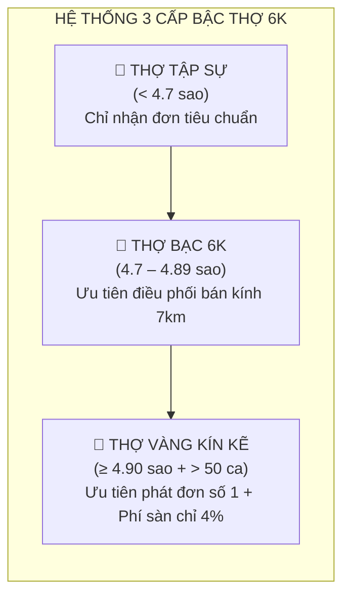
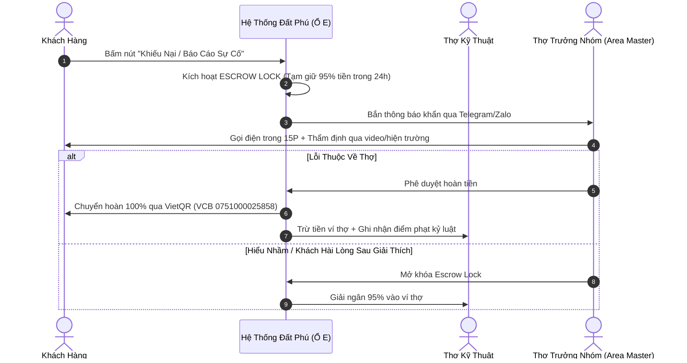

# BỘ TIÊU CHÍ ĐÁNH GIÁ, XẾP HẠNG VÀ THƯỞNG PHẠT ĐỘI THỢ KỸ THUẬT 6K
**CÔNG TY TNHH THƯƠNG MẠI ĐẤT PHÚ (MST: 4401020233)**  
*Trụ sở: Số 21/146 Ngô Gia Tự, P. Phú Yên, TP. Tuy Hòa, Tỉnh Phú Yên*  
*Quy chuẩn chất lượng: Đất Phú Kín Kẽ OS™ • Chuẩn mực thợ bản địa 6K*

---

## 1. HỆ THỐNG ĐÁNH GIÁ 4 TRỤ CỘT CHẤT LƯỢNG (4-PILLAR RATING)

Sau khi thợ hoàn thành công việc và khách hàng cung cấp mã OTP 4 số (K5), màn hình khách hàng sẽ tự động hiển thị biểu mẫu đánh giá sao (1–5 sao) kèm các tiêu chí chi tiết:

| Trụ Cột Đánh Giá | Trọng Số | Tiêu Chí Đo Lường Cụ Thể | Cách Thức Xác Minh |
| :--- | :---: | :--- | :--- |
| **1. Tốc Độ Có Mặt (Speed)** | 25% | Có mặt tại nhà khách trong vòng 15–20 phút kể từ lúc nhận lệnh điều phối. | Chụp ảnh Geostamp K4 có tọa độ GPS & mốc giờ thực tế. |
| **2. Kỷ Luật Giá K3 (Discipline)** | 35% | Thu đúng giá niêm yết, giải thích rõ ràng trước khi tháo lắp, tuyệt đối không vòi vĩnh phụ phí. | So khớp biên bản nghiệm thu với bảng giá niêm yết hệ thống. |
| **3. Tay Nghề & An Toàn (Skill)** | 25% | Xử lý dứt điểm sự cố, đo đạc an toàn điện/áp suất gas bằng đồng hồ chuẩn, không làm hỏng thiết bị xung quanh. | Máy móc vận hành êm, khách bật thử máy nghiệm thu trước khi cấp OTP. |
| **4. Thái Độ & Vệ Sinh (Attitude)** | 15% | Ăn mặc gọn gàng, đeo thẻ thợ Đất Phú, lịch sự và thu dọn sạch sẽ hiện trường sau khi sửa. | Đánh giá trực tiếp của khách hàng qua checklist phản hồi. |

---

## 2. PHÂN HẠNG NĂNG LỰC THỢ (RANKING TIERS)

Hệ thống phân hạng tự động được cập nhật vào 00:00 Chủ Nhật hàng tuần dựa trên điểm đánh giá trung bình 30 ngày gần nhất:

1. **🥇 THỢ VÀNG KÍN KẼ (Gold Master):**
   * **Điều kiện:** Đánh giá $\ge 4.90$ sao, hoàn thành tối thiểu 50 ca thành công, tỷ lệ khiếu nại $0\%$.
   * **Đặc quyền:** Được hệ thống n8n ưu tiên bắn đơn đầu tiên trong bán kính 10km; Giảm phí sàn từ $5\%$ xuống $4\%$ (Thợ hưởng $96\%$ thu nhập ròng); Được tài trợ đồng phục cao cấp và gắn huy hiệu Thợ Vàng trên bản đồ OpenStreetMap.
2. **🥈 THỢ BẠC 6K (Silver Tech):**
   * **Điều kiện:** Đánh giá từ $4.70 - 4.89$ sao, chấp hành đầy đủ quy trình OTP K5.
   * **Quyền lợi:** Phân bổ đơn đều đặn theo tỷ lệ chuẩn $95\% / 5\%$.
3. **🥉 THỢ TẬP SỰ / CẢNH BÁO (Probationary):**
   * **Điều kiện:** Đánh giá $< 4.60$ sao hoặc có từ 2 phản ánh tiêu cực trong tháng.
   * **Chế tài:** Tạm dừng phân bổ đơn "Cứu hộ khẩn cấp 15P"; Bắt buộc kèm cặp bởi Thợ Trưởng Nhóm (Area Master) trong 7 ngày để sát hạch lại tay nghề.

---

## 3. CƠ CHẾ THƯỞNG PHẠT MINH BẠCH (REWARD & PENALTY)

### A. Chính Sách Khen Thưởng (Thúc Đẩy Động Lực)
* **Thưởng Ngôi Sao Tuần (Top Performer):** Thợ có số ca hoàn thành nhiều nhất tuần và đạt 5.0 sao được thưởng nóng **500.000 VNĐ** cộng trực tiếp vào ví.
* **Thưởng Thần Tốc (Speed Bonus):** Thợ có mặt dưới 12 phút trong các ca cứu hộ khẩn cấp được cộng **20.000 VNĐ/ca** từ Quỹ Phát Triển Đất Phú.
* **Thưởng Không Khiếu Nại (Zero Complaint):** Duy trì 3 tháng liên tục không có ca bảo hành lại được thưởng **1.000.000 VNĐ** và vinh danh đối tác tiêu biểu.

### B. Quy Định Xử Phạt Kín Kẽ (Bảo Vệ Khách Hàng Tuyệt Đối)

| Vi Phạm | Hậu Quả & Biện Pháp Xử Lý | Khắc Phục Đối Với Khách Hàng |
| :--- | :--- | :--- |
| **Tự ý nâng giá ngoài niêm yết K3** | • Phạt 500.000 VNĐ khấu trừ ví thợ. • Tạm đình chỉ nhận đơn 7 ngày. • Tái phạm: Khóa vĩnh viễn. | Hoàn trả 100% số tiền chênh lệch cho khách trong 2 giờ + Tặng Voucher 100K. |
| **Đến muộn > 20 phút không báo trước** | • Trừ 50.000 VNĐ điểm kỷ luật ca trực. • Giảm độ ưu tiên nhận đơn trong 48h. | Tự động giảm giá 10% ca sửa chữa cho khách hàng. |
| **Làm ẩu gây hư hỏng thiết bị khách** | • Thợ chịu trách nhiệm 100% chi phí linh kiện. • Trích Quỹ Bảo Chứng K6 ứng trước để đền bù. | Đất Phú cử Thợ Vàng tới thay mới linh kiện chính hãng miễn phí trong 24h. |
| **Tiết lộ số điện thoại / Quấy rối khách** | • Khóa tài khoản vĩnh viễn. • Bàn giao cơ quan chức năng nếu nghiêm trọng. | Đại diện Công ty Đất Phú tới xin lỗi trực tiếp và bảo mật thông tin. |

---

## 4. LUỒNG KIỂM SOÁT KHIẾU NẠI & ĐỐI SOÁT K5 (DISPUTE ESCROW)

---

## 5. BẢO HÀNH ĐIỆN TỬ QR (K6) — AN TÂM TUYỆT ĐỐI
* Mọi ca sửa chữa thành công đều sinh ra một **Mã QR Bảo Hành Điện Tử**.
* Khách hàng chỉ cần quét mã QR bằng camera điện thoại để:
  1. Tra cứu thời hạn bảo hành còn lại (3 tháng đến 12 tháng).
  2. Xem danh tính và số điện thoại người thợ đã trực tiếp sửa chữa.
  3. Bấm 1 nút **"Yêu Cầu Thợ Bảo Hành Tận Nhà"** hoàn toàn miễn phí nếu sự cố lặp lại.
